<div align="center">

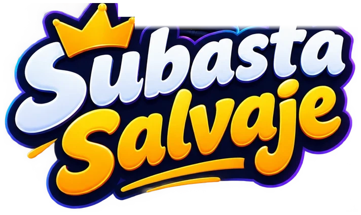


### Puja. Construye. Alucina.

**Subasta creativa multijugador para noches de juegos.** Cada jugador parte de una casa vacía y un presupuesto; la tele muestra el espectáculo, el anfitrión dirige la subasta y cada compra hace que la casa **evolucione** con pegatinas (sin IA) o con edición de imagen por IA.


[](LICENSE)

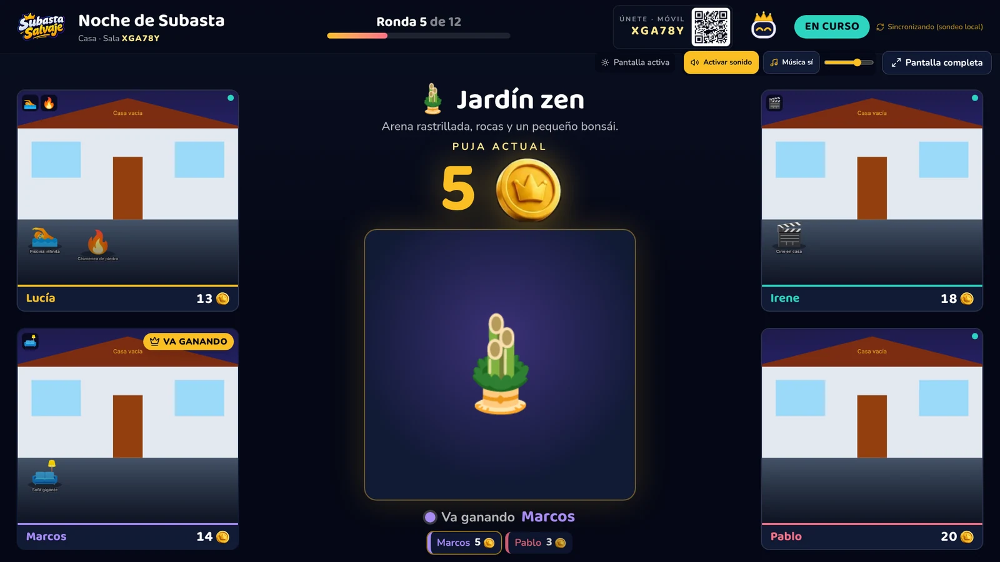

<sub>Vista de TV (1920×1080) durante una puja. Captura real en modo demo (pegatinas locales, sin IA).</sub>

</div>

## Índice

1. [Qué es y cómo se juega](#qué-es-y-cómo-se-juega)
2. [Características](#características)
3. [Galería](#galería)
4. [Inicio rápido (modo demo)](#inicio-rápido-modo-demo)
5. [Variables de entorno](#variables-de-entorno)
6. [Arquitectura](#arquitectura)
7. [Estructura del repositorio](#estructura-del-repositorio)
8. [Guía de referencia](#guía-de-referencia) (Supabase, IA, cola, Vercel, reglas avanzadas, superadmin…)
9. [Pruebas y calidad](#pruebas-y-calidad)
10. [Despliegue](#despliegue)
11. [Seguridad y honestidad](#seguridad-y-honestidad)
12. [Costes y servicios externos](#costes-y-servicios-externos)
13. [Solución de problemas](#solución-de-problemas)
14. [Documentación](#documentación)
15. [Licencia y créditos](#licencia-y-créditos)
16. [Mantener este README al día](#mantener-este-readme-al-día)

---

## Qué es y cómo se juega

1. **Crea la partida** en `/new-game` (asistente de 6 pasos o importando una plantilla JSON): temática, presupuesto, reglas y jugadores.
2. **La tele** (`/game/[código]/screen`) muestra la sala de espera con el código y un QR; los jugadores entran desde el móvil en `/join` (modo «móviles») o pujan en voz alta (modo «anfitrión»).
3. **El anfitrión** (`/game/[código]/host`, privado) anuncia un elemento, recoge pujas, cierra y adjudica; o activa la **subasta automática**.
4. **Cada compra se cobra una sola vez** y la casa del ganador evoluciona: pegatinas con emojis (sin IA, gratis e instantáneo) o edición por IA si el despliegue la tiene configurada.
5. **Al final**, los jugadores votan la mejor casa desde el móvil; cuando todos han votado, la TV pasa sola al **podio**.

<table>
<tr>
<td width="33%" align="center">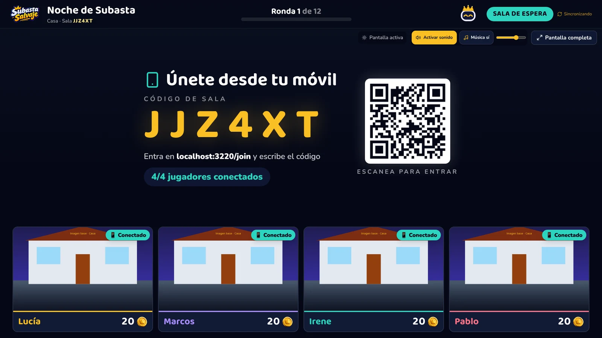<br><sub>Sala de espera: código y QR para unirse</sub></td>
<td width="33%" align="center">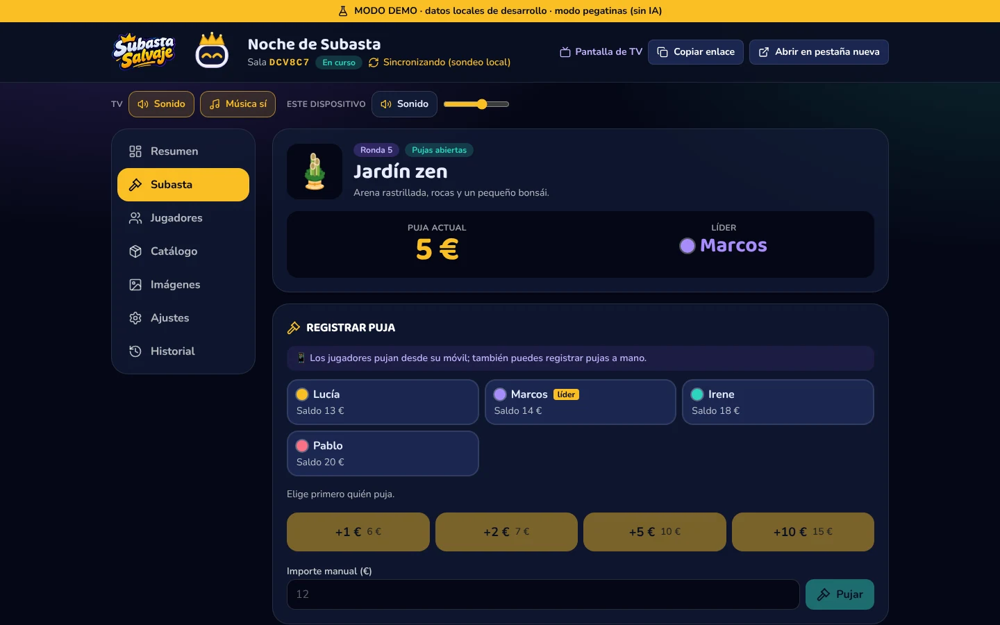<br><sub>Panel del anfitrión: pujas y control</sub></td>
<td width="33%" align="center">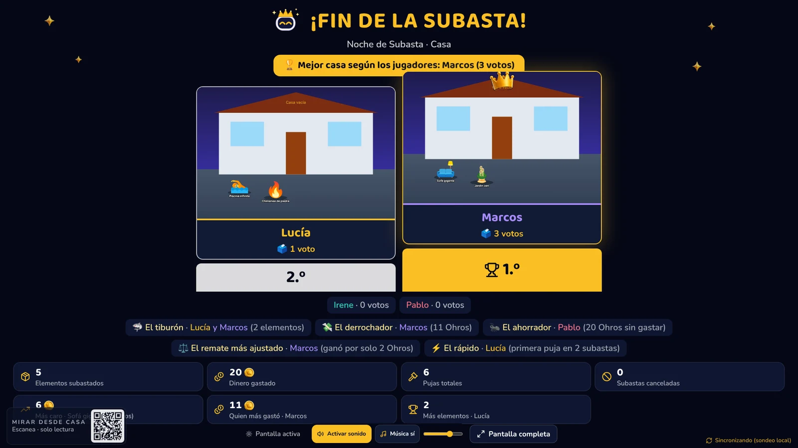<br><sub>Podio tras la votación</sub></td>
</tr>
</table>

Rutas principales: `/` (inicio) · `/new-game` · `/login` · `/join` · `/game/[código]/{screen,host,play,results,history}` · `/admin` (superadmin) · `/setup` (diagnóstico) · páginas legales (`/legal`, `/privacidad`, `/cookies`, `/creditos`, `/licencia`).

## Características

- **Dos modalidades** (se eligen al crear la partida y se cambian en Ajustes mientras esté en la sala de espera):
  - **Pujas del anfitrión:** los jugadores pujan en voz alta y el anfitrión las registra; no necesitan cuenta ni móvil.
  - **Cada jugador desde su móvil:** entran con el código de sala o el QR, eligen nombre y pujan ellos mismos (sin cuenta: cookie `httpOnly` por jugador).
- **Casas que evolucionan:** modo **pegatinas con emojis (sin IA)** por defecto, o modo **con IA** (cadena de proveedores gratuitos: Cloudflare Workers AI, Pollinations, AI Horde y Hugging Face; OpenAI solo si es el único y lo pides, con cuotas por partida y por día e interruptor de apagado). Nunca se activa un proveedor de pago por sí solo. La subasta nunca se bloquea por la IA.
- **Subasta automática y adjudicación automática** (por tiempo o instantánea), rondas máximas, pujas en euros enteros, **eventos sorpresa** (a ciegas, doble o mitad, impuesto al más rico) y **deshacer** la última adjudicación.
- **Votación y podio:** galería final con voto de cada jugador (no se puede votar a uno mismo); la votación se cierra sola cuando todos los conectados han votado y la TV muestra el podio.
- **Plantillas de partida** (JSON, CSV de catálogo o ZIP con fotos): importar, editar el catálogo, guardar y exportar. Ver [`docs/PLANTILLAS.md`](docs/PLANTILLAS.md).
- **Sonido y música** sintetizados en el navegador (sin archivos de audio), con control del anfitrión. Ver [`docs/SONIDO.md`](docs/SONIDO.md).
- **Panel de superadmin** (`/admin`): peso de la base de datos y del almacenamiento, cuota de IA, usuarios, partidas, ajustes en caliente y auditoría.
- **Responsive:** móvil, escritorio y TV (≥ 1536 px, con foco visible para mando o teclado); respeta `prefers-reduced-motion`.
- **Miniaturas al compartir** (Open Graph) con el código de sala, borrado automático de partidas inactivas y páginas legales ([`docs/OPEN-GRAPH.md`](docs/OPEN-GRAPH.md), [`docs/LEGAL.md`](docs/LEGAL.md)).

## Galería

Todas las capturas son **reales**, generadas con la app en **modo demo (pegatinas locales sin IA)** mediante `node scripts/docs/screenshots.mjs`.

<table>
<tr>
<td width="50%" align="center">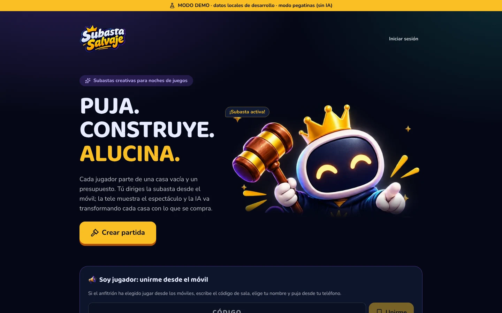<br><sub>Inicio (escritorio)</sub></td>
<td width="25%" align="center">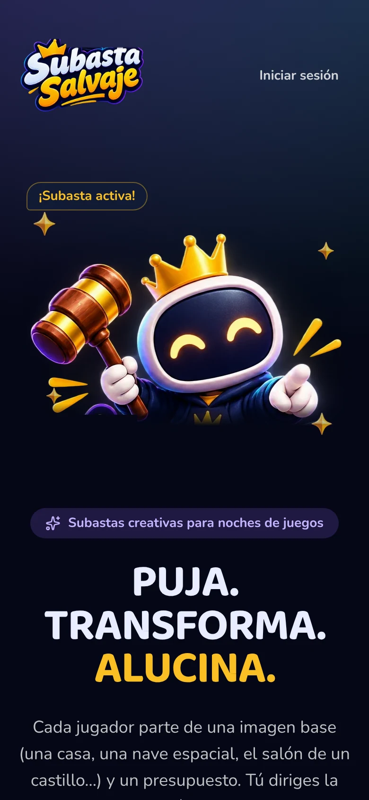<br><sub>Inicio (móvil)</sub></td>
<td width="25%" align="center">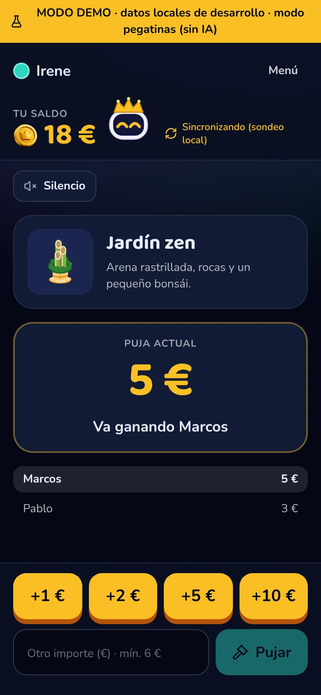<br><sub>Jugador pujando desde el móvil</sub></td>
</tr>
<tr>
<td width="50%" align="center">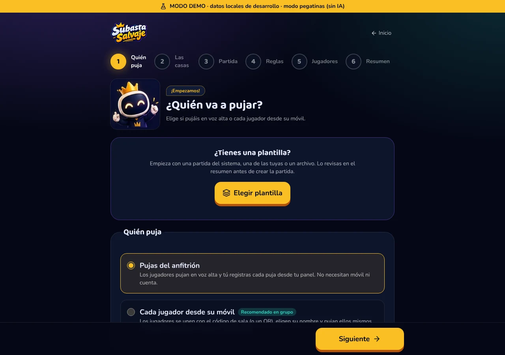<br><sub>Nueva partida · paso 1 de 6</sub></td>
<td width="25%" align="center">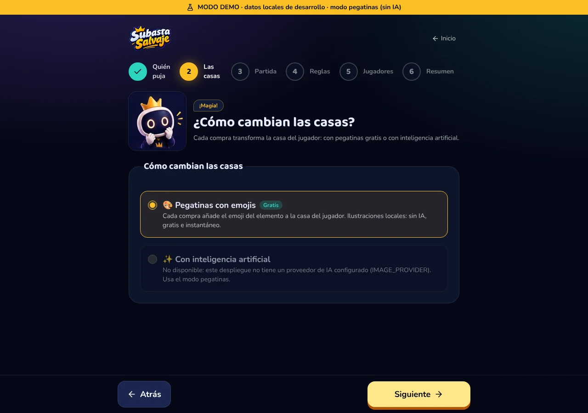<br><sub>Nueva partida · paso 2 (casas)</sub></td>
<td width="25%" align="center">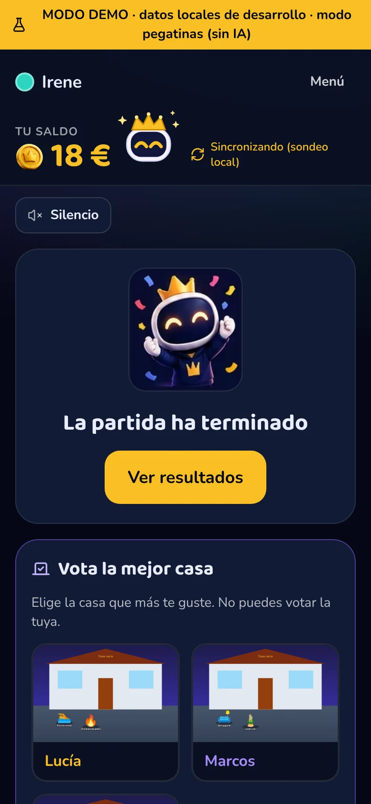<br><sub>Votación en el móvil</sub></td>
</tr>
<tr>
<td width="50%" align="center">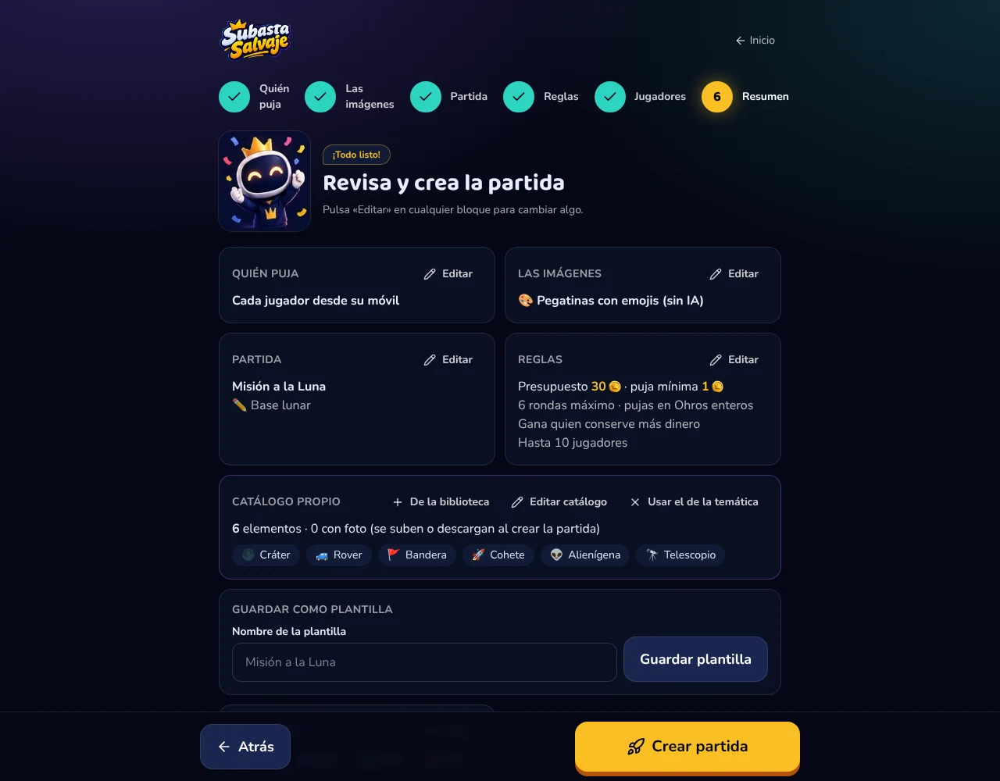<br><sub>Plantilla importada: resumen</sub></td>
<td width="25%" align="center">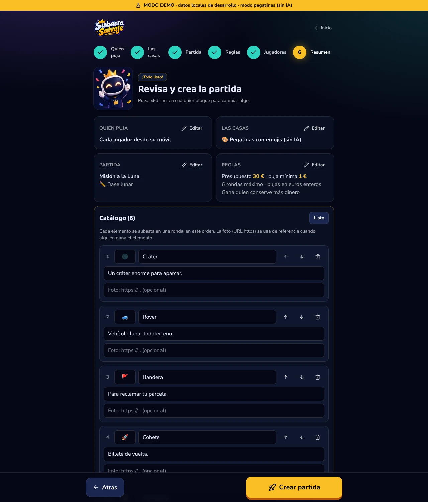<br><sub>Editor de catálogo</sub></td>
<td width="25%" align="center">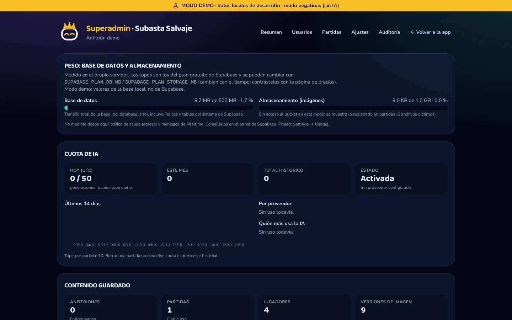<br><sub>Superadmin</sub></td>
</tr>
<tr>
<td colspan="3" align="center">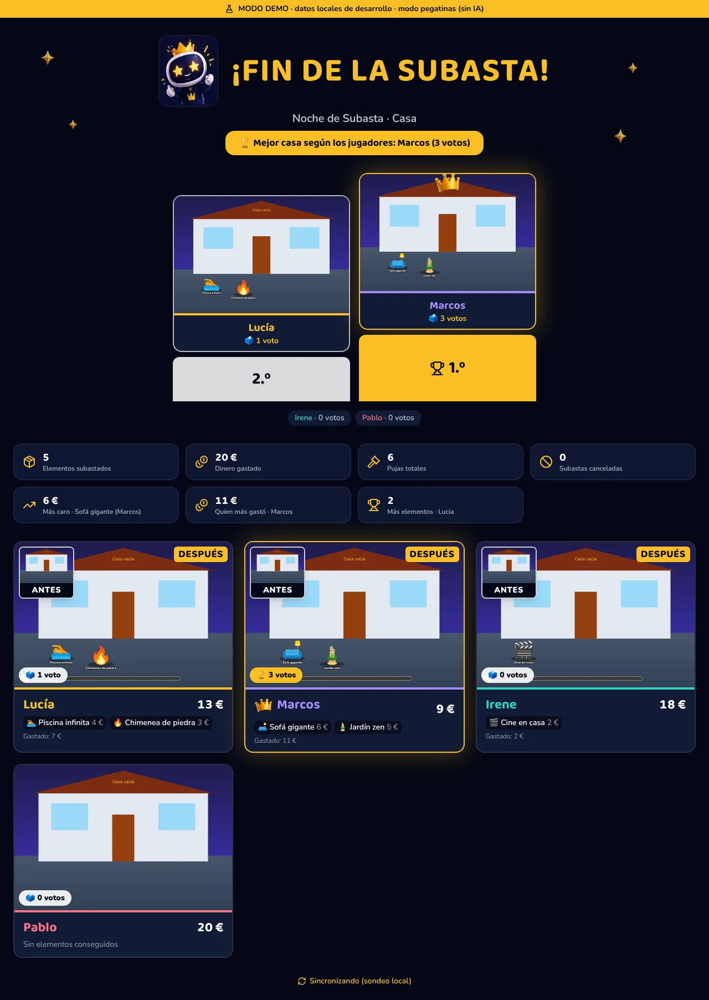<br><sub>Resultados con podio, estadísticas y casas «antes / después»</sub></td>
</tr>
</table>

### Repositorio hermano de imágenes: [subasta-salvaje-public](https://github.com/ElMaxter99/subasta-salvaje-public)

Las fotos de las **partidas del sistema** (Halloween, casa encantada, batido…) no viven en este repositorio ni en Supabase, sino en [`ElMaxter99/subasta-salvaje-public`](https://github.com/ElMaxter99/subasta-salvaje-public), un repositorio público sin ánimo de lucro que la app llena con el arrastrar y soltar de `/admin/plantillas` y que se sirve por jsDelivr. Ese repositorio enlaza de vuelta a este proyecto. Configuración en `GITHUB_ASSETS_*` (ver variables de entorno) y [`docs/PLANTILLAS-SISTEMA.md`](docs/PLANTILLAS-SISTEMA.md).

### Recursos gráficos del proyecto

| Recurso | Dónde | Notas |
|---|---|---|
| Logo y mascota de marca | [`public/assets/brand/`](public/assets/brand/) | Ver [`docs/MARCA.md`](docs/MARCA.md) (limitaciones del logo raster) |
| Expresiones, poses y objetos de la mascota | [`public/assets/mascot/`](public/assets/mascot/) | Recortes de la lámina de referencia; ver [`docs/MASCOTA.md`](docs/MASCOTA.md) |
| Mascota vectorial con transparencia real (15 expresiones + 12 poses, WebP 512 px) | [`public/assets/mascot-vector/`](public/assets/mascot-vector/) | `npm run mascot:vector`; componente `<MascotVector>`; ver [`docs/MASCOTA.md`](docs/MASCOTA.md) |
| Asset pack vectorial (mascota, props, UI, VFX) | [`subasta-salvaje-assets/`](subasta-salvaje-assets/) | Se regenera con `npm run assets:build`; **aún no integrado en la UI**, ver [`docs/ASSETS.md`](docs/ASSETS.md) |

<table>
<tr>
<td align="center">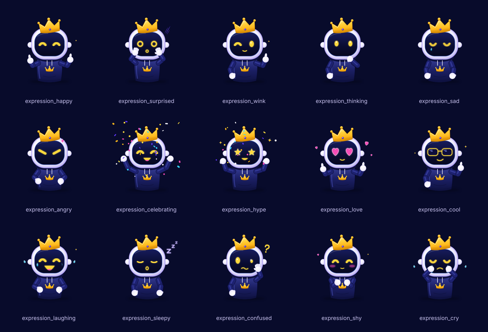<br><sub>Asset pack: expresiones</sub></td>
<td align="center">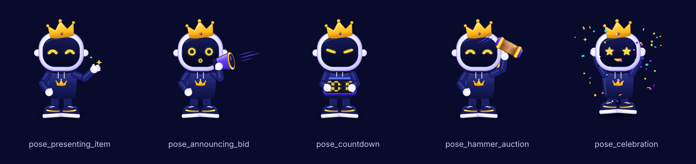<br><sub>Asset pack: poses</sub></td>
</tr>
<tr>
<td colspan="2" align="center">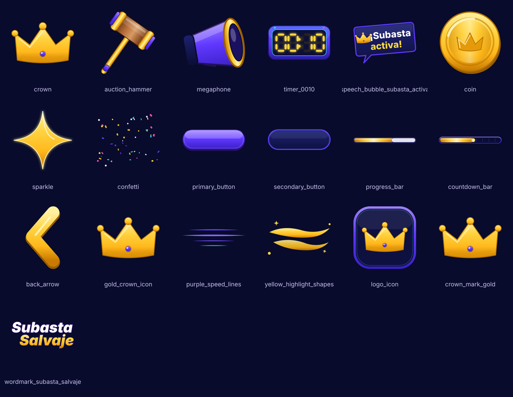<br><sub>Asset pack: props, UI, VFX y marca (ilustraciones vectoriales aproximadas, no 3D ni IA)</sub></td>
</tr>
</table>

## Inicio rápido (modo demo)

Requisitos: Node.js ≥ 20 y npm. **No hace falta ninguna credencial**: sin variables de Supabase y fuera de producción, la app arranca en **modo demo** (PGlite local en `./.demo-data`, acceso de anfitrión con un botón, pegatinas sin IA y un banner amarillo permanente de «datos locales»).

```bash
npm install
npm run dev            # http://localhost:3000  → modo demo si no hay .env.local
```

1. Abre `http://localhost:3000`, pulsa **Crear partida** → **Entrar como anfitrión (demo)** (o «Cargar partida de ejemplo (demo)» para ver la interfaz con datos).
2. Crea la partida (el asistente sugiere valores por defecto). En el panel, aplica la imagen inicial a todos y pulsa **Empezar partida**.
3. Abre la **pantalla de TV** («Abrir en pestaña nueva») en otra ventana o dispositivo de la misma red: `http://IP-DE-TU-PC:3000/game/CÓDIGO/screen`.

### Scripts de npm

| Script | Qué hace |
|---|---|
| `npm run dev` / `build` / `start` | Desarrollo, build de producción y servidor de producción |
| `npm run lint` / `typecheck` | ESLint y `tsc --noEmit` |
| `npm test` | Vitest (SQL real sobre PGlite, servicios, proveedores, validación) |
| `npm run test:e2e` | Playwright (Chromium) en modo demo |
| `npm run worker` | Procesa la cola de imágenes en local (solo con Supabase) |
| `npm run scan:secrets` | Busca credenciales en archivos, historial de git y bundle del navegador |
| `npm run assets:build` | Regenera `subasta-salvaje-assets/` |
| `npm run mascot:extract` | Regenera los recortes de `public/assets/mascot/` |
| `npm run mascot:vector` | Exporta la mascota vectorial (alfa real) a `public/assets/mascot-vector/` |
| `npm run mascot:chroma` | Quita un fondo verde liso de un render (`-- entrada.png --out salida.webp`) |
| `npm run brand:build` / `brand:mini` | Regenera logo e iconos de marca / el mini héroe vectorial |
| `npm run ai:measure` | Mide con TUS credenciales de Cloudflare 1 generación (y con `--edit`, 1 edición) para calcular cuánta cuota gratuita gasta cada llamada; sin `--yes` solo muestra qué haría (gasta cuota real: ejecútalo tú) |
| `npm run emails:build` | Genera las plantillas de correo de Supabase Auth |
| `node scripts/docs/screenshots.mjs` | Regenera las capturas de `docs/img/` (ver [Mantener este README al día](#mantener-este-readme-al-día)) |

Con Supabase en local (opcional, Docker): `npx supabase init` (una vez) · `npx supabase start` · `npx supabase db reset` (aplica `supabase/migrations/*.sql`) · `npx supabase status` (URL y claves para `.env.local`). Para el modo real sigue [Configurar Supabase](#configurar-supabase).


## Variables de entorno

Plantilla sin valores: [`.env.example`](.env.example). Nunca subas `.env*` al repositorio.

| Variable | Obligatoria | Dónde | Descripción |
|---|---|---|---|
| `NEXT_PUBLIC_SUPABASE_URL` | Sí (modo real) | cliente+servidor | URL del proyecto Supabase. |
| `NEXT_PUBLIC_SUPABASE_ANON_KEY` | Sí (modo real) | cliente+servidor | Clave pública (sin permisos sobre tablas por RLS). |
| `SUPABASE_SERVICE_ROLE_KEY` | Sí (modo real) | **solo servidor** | Clave de servicio. Nunca en el navegador. |
| `SUPABASE_STORAGE_BUCKET` | No | servidor | Bucket de imágenes (por defecto `game-images`). |
| `IMAGE_PROVIDER` | No (vacío = sin IA) | servidor | `cloudflare` \| `openai`. Activa el modo «Con IA». Ninguna credencial lo activa sin esto. |
| `POLLINATIONS_API_KEY` | Con `pollinations` | **solo servidor** | Clave de Pollinations (`sk_…`). Opcionales: `POLLINATIONS_IMAGE_MODEL`, `POLLINATIONS_EDIT_MODEL` (vacío = sin edición real), `POLLINATIONS_IMAGE_SIZE`. **Sin probar contra el servicio real**; límites y términos sin verificar. |
| `AI_HORDE_API_KEY`, `AI_HORDE_MODELS`, `AI_HORDE_SIZE`, `AI_HORDE_MAX_WAIT_SECONDS` | No | servidor | **AI Horde** (GPU de voluntarios, gratuita, sin tarjeta): entra en la cadena con `IMAGE_PROVIDERS=…,aihorde`. Sin clave usa la anónima (menor prioridad en la cola). Solo genera; la cola puede tardar. **Sin probar contra el servicio real.** |
| `HF_TOKEN`, `HF_IMAGE_MODEL` | Con `huggingface` | **solo servidor** | **Hugging Face** Inference Providers (crédito gratuito mensual pequeño). Solo genera. **Sin probar contra el servicio real.** |
| `IMAGE_PROVIDERS` | No | servidor | Lista ordenada de proveedores **gratuitos** con fallback automático (cuota, límite, credenciales, red). Sustituye a `IMAGE_PROVIDER`. Gratuitos: `cloudflare`, `pollinations`, `aihorde` y `huggingface` (p. ej. `cloudflare,pollinations,aihorde`); `openai` (de pago) no puede ir en una lista de varios. |
| `CLOUDFLARE_ACCOUNT_ID`, `CLOUDFLARE_API_TOKEN` | Con `cloudflare` | **solo servidor** | Credenciales de Workers AI. |
| `CLOUDFLARE_IMAGE_MODEL`, `_IMAGE_STEPS`, `CLOUDFLARE_EDIT_MODEL`, `_EDIT_WIDTH`, `_EDIT_HEIGHT` | No | servidor | Modelos y parámetros (ver arriba). |
| `IMAGE_QUOTA_PER_GAME`, `IMAGE_QUOTA_PER_DAY` | No (10 / 50) | servidor | Límite de generaciones reales por partida y por día. |
| `IMAGE_AI_DISABLED` | No | servidor | `true` = interruptor de seguridad: apaga toda la IA real. |
| `OPENAI_API_KEY` | Con `openai` | **solo servidor** | Alternativa de pago. |
| `OPENAI_IMAGE_MODEL` / `_SIZE` / `_QUALITY` / `_INPUT_FIDELITY` / `OPENAI_BASE_URL` | No | servidor | Ajustes del proveedor. |
| `ALLOWED_HOST_EMAILS` | Recomendada | servidor | Correos autorizados como anfitrión (evita gasto de IA por terceros). |
| `GAME_TTL_HOURS` | No (168) | servidor | Horas de inactividad tras las que una partida se borra sola (7 días). El superadmin lo cambia en caliente desde `/admin`. |
| `SUPERADMIN_REQUIRE_MFA` | No | servidor | `true` = el panel `/admin` exige verificación en dos pasos (TOTP de Supabase Auth). Antes hay que activar MFA/TOTP en Supabase. Sin probar contra Supabase real; si algo falla, quita la variable. |
| `SUPERADMIN_EMAILS` | Para usar `/admin` | servidor | Correo(s) del superadmin (con el correo confirmado). Sin ella `/admin` da 404. En modo demo el anfitrión local es superadmin. |
| `SUPABASE_PLAN_DB_MB` / `SUPABASE_PLAN_STORAGE_MB` | No (500 / 1024) | servidor | Topes del plan de Supabase que muestran las barras del panel (solo informativos). |
| `GITHUB_ASSETS_REPO`, `GITHUB_ASSETS_TOKEN` | Para subir fotos de plantillas | **solo servidor** | Repositorio público de fotos (`usuario/repo`) y token fino con *Contents: Read and write* solo sobre él. Activan el arrastrar y soltar de `/admin/plantillas` (las fotos van a GitHub + jsDelivr, no a Supabase). Opcional `GITHUB_ASSETS_BRANCH` (`main`). **Sin probar contra GitHub real.** |
| `ASSET_CDN_HOSTS` | No (recomendada) | servidor | Servidores permitidos para las fotos de las plantillas del sistema (`cdn.tudominio.com`, separados por comas). Vacía = cualquier https. |
| `NEXT_PUBLIC_DISABLE_ANALYTICS` | No | cliente | `true` desactiva Vercel Web Analytics (ver «Analítica»). |
| `RESEND_API_KEY` | Opcional (con `MAIL_FROM`) | **solo servidor** | Clave de Resend (`re_…`) para que la app envíe sus propios correos con su marca (confirmación, recuperación, invitaciones). Sin ella, el registro es solo por invitación y la recuperación usa el correo de Supabase. |
| `MAIL_FROM` | Con `RESEND_API_KEY` | servidor | Remitente de un dominio verificado en Resend, p. ej. `Subasta Salvaje <no-reply@tudominio.com>`. |
| `MAIL_REPLY_TO` | No | servidor | Dirección de respuesta. |
| `CRON_SECRET` | Recomendada | servidor | Protege `/api/jobs/process` y `/api/jobs/purge`. |
| `NEXT_PUBLIC_SITE_URL` | No | cliente+servidor | URL pública del despliegue (enlaces absolutos, Open Graph, correos). |
| `FORCE_DEMO_MODE`, `ALLOW_DEMO_MODE`, `DEMO_DATA_DIR`, `WORKER_INTERVAL_MS` | No | servidor | Desarrollo / worker. |

Operaciones y diagnóstico: [`docs/OPERACIONES.md`](docs/OPERACIONES.md).

## Arquitectura

**Regla de oro:** toda la lógica de dinero, pujas, adjudicación, imágenes y reglas vive en **funciones SQL `ss_*`** (PL/pgSQL). TypeScript solo valida (Zod), autentica, llama a `rpc('ss_*')` y presenta.

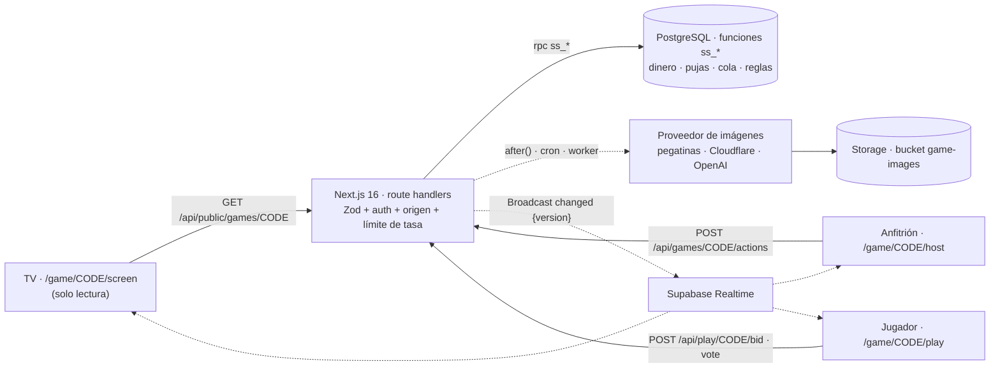

Los clientes releen el estado de la BD (fuente de verdad) y solo aplican versiones **mayores**; además hacen *polling* de seguridad. En **modo demo y en los tests se ejecuta el mismo SQL sobre [PGlite](https://pglite.dev)** (PostgreSQL real compilado a WASM). Capas, catálogo de funciones y migraciones en orden: [`docs/ARQUITECTURA.md`](docs/ARQUITECTURA.md).

Decisiones clave:

- **Una única implementación de la lógica de juego: SQL.** Toda la lógica de dinero, pujas, adjudicación y cola de imágenes vive en funciones PL/pgSQL (`supabase/migrations/20260101000000_core.sql`, funciones `ss_*`). En producción se invocan con `supabase.rpc`; en el modo demo y en los tests se ejecuta **el mismo SQL** sobre [PGlite](https://pglite.dev) (PostgreSQL real compilado a WASM). No hay dos implementaciones divergentes.
- **Atomicidad e idempotencia.** Cada función mutante bloquea la fila de la partida (`SELECT … FOR UPDATE`), de modo que las operaciones de una partida se serializan. `ss_award` verifica estado, saldo y datos esperados (`expected_winner_id`, `expected_price_cents`), cierra la subasta, descuenta el saldo, crea la compra (`UNIQUE(auction_id)`) y el trabajo de imagen (`UNIQUE(purchase_id)`) en **una sola transacción**. Un doble clic, una recarga o un reintento HTTP no pueden cobrar dos veces. Importes siempre en **céntimos enteros**.
- **Seguridad por servidor.** El navegador nunca habla con las tablas: RLS está activado sin permisos para `anon`/`authenticated`, y todo pasa por rutas de Next.js que verifican la sesión de Supabase Auth y la propiedad de la partida (`games.host_id`), con la `service_role` solo en el servidor.
- **Realtime compatible con Vercel.** Sin servidor WebSocket propio: Supabase Realtime *Broadcast* (publicado por REST desde el servidor) + *polling* de seguridad. La BD es la fuente de verdad; un evento duplicado o atrasado se ignora comparando `version`.
- **Imágenes.** `ImageGenerationProvider` (`src/lib/ai/types.ts`) con `generateInitialScene`, `editScene` y `generateItemImage`. Proveedor real: OpenAI `gpt-image-1` (edición con imagen de referencia, `input_fidelity=high`). Proveedor `demo`: SVG locales marcados «DEMO» (no es IA).

## Estructura del repositorio

```
supabase/migrations/   SQL autoritativo (esquema, funciones ss_*, permisos _security_)
src/lib/domain/        schemas Zod, tipos, errores, dinero, ranking, temáticas
src/lib/services/      game-service, play-service, jobs-service, context, seed, page-data
src/lib/db/            pglite.ts (demo/tests) · supabase.ts (rpc)
src/lib/ai/            proveedores de imagen (pegatinas, cloudflare, openai), compose, prompts, validación
src/lib/{auth,security,realtime,storage,client,config,audio,legal}/
src/app/               páginas y /api/*
src/components/        host · screen · play · ui · landing · mascot · admin · legal
public/assets/         brand/ (logo, mascota nueva, iconos) · mascot/ (expresiones, poses, objetos) · fonts/
subasta-salvaje-assets/  asset pack vectorial (mascota, props, UI, VFX)
tests/  e2e/  scripts/   Vitest · Playwright · scripts (assets, mascota, marca, correos, capturas de docs)
docs/                  documentación técnica (índice en docs/README.md) y docs/img/ (capturas del README)
```

## Guía de referencia

Detalle operativo y de reglas. Despliega cada bloque para leerlo; la memoria técnica complementaria está en [`docs/`](docs/README.md).

<details>
<summary><b>Qué funciona sin credenciales (modo demo)</b></summary>

Si **no** defines las variables de Supabase y `NODE_ENV !== 'production'`, la app arranca en **modo demo**:

- Base de datos local PGlite (`./.demo-data/pgdata`), imágenes en disco (`./.demo-data/images`).
- Acceso de anfitrión con un botón (sin cuenta).
- El modo de imágenes **pegatinas** (escenas SVG y emojis de los elementos) es local y no usa IA; en el modo demo la interfaz muestra además un banner amarillo permanente de «datos locales».
- Con `IMAGE_PROVIDER=cloudflare` (u `openai`) y sus credenciales en modo demo se usa la IA real (la BD y el almacenamiento siguen siendo locales). Solo `IMAGE_PROVIDER` activa un proveedor real: tener credenciales en el entorno no basta.
- En producción sin credenciales la app **no** cae a modo demo: muestra `/setup` con lo que falta (salvo que fuerces `ALLOW_DEMO_MODE=true`, no recomendado).
- El botón «Cargar partida de ejemplo (demo)» de la landing crea una partida con jugadores, compras e imágenes para probar la interfaz.

</details>

<details id="configurar-supabase">
<summary><b>Configurar Supabase (modo real)</b></summary>

1. Crea un proyecto en <https://supabase.com> (el plan gratuito basta para jugar).
2. **Aplicar migraciones.** Hay 36 archivos en `supabase/migrations/` (cada función lleva su migración y su `…_security_…`, que revoca permisos a `anon`/`authenticated` y concede a `service_role`). Aplícalos **todos y en orden de nombre** (el orden y el contenido de cada uno están en [`docs/ARQUITECTURA.md`](docs/ARQUITECTURA.md)). Con la CLI: `npx supabase link --project-ref TU_REF && npx supabase db push`. En el *SQL Editor* de Supabase puedes pegar uno a uno, empezando por `20260101000000_core.sql` y `20260101000100_security.sql`. Si ya aplicaste archivos a mano, antes marca esas versiones: `npx supabase migration repair --status applied 20260101000000 20260101000100 …`. Nunca edites una migración ya aplicada: crea otra.
3. **Claves.** *Project Settings → API*: copia `Project URL` → `NEXT_PUBLIC_SUPABASE_URL`, `anon public` → `NEXT_PUBLIC_SUPABASE_ANON_KEY` y `service_role` → `SUPABASE_SERVICE_ROLE_KEY` (**secreta**, solo servidor).
4. **Auth.** *Authentication → Providers → Email* activado. Para jugar rápido puedes desactivar *Confirm email*; si lo dejas activo, el anfitrión debe confirmar su correo tras registrarse. En *Authentication → URL Configuration* pon tu dominio de Vercel como *Site URL*.
5. **Storage.** La migración de seguridad crea el bucket `game-images` (público de **lectura**, máx. 10 MB, solo PNG/JPEG/WebP). Nadie salvo el servidor (`service_role`) puede subir, modificar ni listar objetos. Comprueba en *Storage* que el bucket existe.
6. **Realtime.** No hay que activar replicación de tablas: se usa *Broadcast* (activo por defecto). Si lo tienes desactivado, en *Project Settings → Realtime* permite *Broadcast*.
7. **RLS.** Verifica en *Database → Tables* que todas las tablas muestran RLS activado y que *Database → Functions* no es ejecutable por `anon` (la migración ya revoca `EXECUTE`).

</details>

<details>
<summary><b>Configurar el proveedor de imágenes (pegatinas, Cloudflare, OpenAI)</b></summary>

Cada **partida** elige su modo de imágenes al crearla (y puede cambiarlo en *Ajustes* mientras esté en la sala de espera):
- **🎨 Pegatinas con emojis** (por defecto): cada compra añade el emoji del elemento a la casa. Son ilustraciones SVG locales: **sin IA, gratis e instantáneo**, y siempre están disponibles. Cada imagen lleva la marca «Modo pegatinas · sin IA» y se guarda con `provider = 'demo'` (la interfaz la etiqueta como «Pegatinas»).
- **✨ Con IA**: usa el proveedor de IA real configurado (`IMAGE_PROVIDER=cloudflare` u `openai`), con cuotas por partida y por día. Esta opción solo aparece disponible si el despliegue tiene IA configurada.

**Ninguna credencial activa la IA por sí sola**: hay que pedirla con `IMAGE_PROVIDER`. Si la pides y faltan credenciales, la IA aparece como «no disponible» (las partidas en modo IA dejan sus trabajos en cola) y **nunca se cambia automáticamente a otro proveedor ni se activa un plan de pago**. Si el proveedor falla, la compra, el saldo y la imagen anterior se conservan y se puede seguir jugando; el trabajo se puede reintentar sin volver a cobrar.

#### Edición con foto de referencia (FLUX.2 klein) y plan B por composición
**Edición real:** con Cloudflare configurado, la app edita la imagen actual de cada jugador usándola como referencia (`@cf/black-forest-labs/flux-2-klein-4b`, ahora **activo por defecto**; cambia el modelo con `CLOUDFLARE_EDIT_MODEL` o pon `off` para desactivarlo). Según la tarifa publicada (≈5,4 neuronas por tile de entrada y ≈26 por tile de salida de 512²) una edición de 1024×768 cuesta unas 85 neuronas, es decir ~110 ediciones al día dentro de las 10 000 neuronas gratuitas; **contrástalo con la página de precios vigente**. El nombre exacto de los campos multipart (`input_image_0`) no pude confirmarlo en la documentación: si el modelo rechaza la entrada (400/404/422) se activa el plan B siguiente; cuota, red o credenciales no lo activan.

**Plan B (composición):** si el modelo de edición no existe, está desactivado (`off`) o rechaza la entrada, la app usa una **edición por composición** (`src/lib/ai/compose.ts`): genera con IA solo el objeto nuevo sobre fondo blanco liso (1 generación, cuenta en la misma cuota), recorta el fondo y lo pega con sombra en un hueco libre de la imagen actual. La escena anterior se conserva píxel a píxel. **Limitación honesta:** es un collage, no una edición real; el objeto no adapta luz ni perspectiva a la casa, y si el modelo no devuelve un fondo liso el recorte falla (se reintenta y, si sigue fallando, se conserva la imagen anterior). Desactívalo con `IMAGE_EDIT_COMPOSE=false`. Probado con respuestas simuladas; **no probado contra la API real de Cloudflare**.

#### Cloudflare Workers AI (primera opción real)

Verificado en la documentación oficial de Cloudflare (consulta de las páginas de modelos y precios; en el entorno de desarrollo no pude abrir las páginas completas, solo sus extractos, así que **contrasta los detalles críticos con la doc vigente y prueba con una llamada real antes de confiar en ellos**):

| Modelo | Uso | Entrada | Salida |
|---|---|---|---|
| `@cf/black-forest-labs/flux-1-schnell` (**por defecto**, el más económico) | Generación texto→imagen: imagen inicial de la casa e imágenes de elementos | JSON `prompt` (1–2048 caracteres), `steps` (1–8, por defecto 4) | `image`: base64 (JPEG) |
| `@cf/black-forest-labs/flux-2-klein-4b` (opcional) | **Edición** multi-referencia | `multipart/form-data`: `prompt`, `width`, `height`, `input_image_0..3` (cada una < 512×512); 4 pasos fijos | `image`: base64 |

Endpoint REST: `POST https://api.cloudflare.com/client/v4/accounts/{CLOUDFLARE_ACCOUNT_ID}/ai/run/{modelo}` con `Authorization: Bearer {CLOUDFLARE_API_TOKEN}`. La respuesta se interpreta como `{ result: { image } }` (también se admite `{ image }` o una imagen binaria).

**Limitación importante:** `flux-1-schnell` **no admite imagen de referencia, así que no puede editar la casa existente**. Con él, la imagen inicial y las imágenes de elementos se generan, pero las ediciones por compra salen como *fallidas* con un mensaje claro (la compra, el saldo y la imagen anterior se conservan; el panel avisa y no gasta cuota). Opciones:
- Definir `CLOUDFLARE_EDIT_MODEL=@cf/black-forest-labs/flux-2-klein-4b`: la app redimensiona la casa actual a < 512 px (con `sharp`) y la envía como `input_image_0`. **Esta ruta está implementada según la documentación y probada solo con respuestas simuladas, no contra la API real**; la calidad de conservación de detalles con referencias tan pequeñas puede ser limitada y el coste por imagen es mayor que el de schnell.
- Usar otro proveedor con edición real (`IMAGE_PROVIDER=openai`) o integrar uno nuevo implementando `ImageGenerationProvider` (`src/lib/ai/types.ts`, ver `capabilities.edit`) y registrándolo en `src/lib/services/context.ts`.

Cuota y coste (según la documentación en el momento de escribir esto, sujeta a cambios): Workers AI incluye **10 000 *neurons* al día gratis**; más allá solo se factura en el plan *Workers Paid* (desde 5 USD/mes), que **no se activa solo**. Algunos modelos exigen el plan de pago (las peticiones del plan gratuito devuelven 403). flux-1-schnell se factura por *tile* de 512×512 (4,80 neurons) y por paso (9,60 neurons); una imagen de 1024×1024 con 4 pasos serían ≈ 58 neurons, es decir, del orden de 170 imágenes/día gratis (estimación mía a partir de esas cifras). Comprueba los precios vigentes en la página oficial de precios de Workers AI.

**Cómo obtener y configurar las credenciales (sin exponerlas en el frontend):**
1. Crea una cuenta en <https://dash.cloudflare.com> (el plan gratuito basta para empezar; **no añadas método de pago** si no quieres cobros).
2. **Account ID:** en el panel, *Workers & Pages* (barra lateral derecha, «Account ID») o en la URL `dash.cloudflare.com/<ACCOUNT_ID>/…`.
3. **API token:** *My Profile → API Tokens → Create Token* → plantilla **«Workers AI»** (o un token personalizado con el permiso *Account · Workers AI*). Cópialo una sola vez.
4. En `.env.local` (local) o *Settings → Environment Variables* de Vercel (Production y Preview) define `IMAGE_PROVIDER=cloudflare`, `CLOUDFLARE_ACCOUNT_ID` y `CLOUDFLARE_API_TOKEN`. Son variables **solo de servidor** (sin prefijo `NEXT_PUBLIC_`): las llamadas a Cloudflare se hacen únicamente en el backend (`/api/…`, worker y `after()`); el navegador nunca ve el token. Los mensajes de error guardados no incluyen el token.
5. Redespliega y comprueba en el panel (pestaña *Imágenes*) el proveedor y el contador de cuota.

#### Límites de generaciones reales
`IMAGE_QUOTA_PER_GAME` (por defecto **10**) e `IMAGE_QUOTA_PER_DAY` (por defecto **50**, global a todas las partidas del despliegue, día UTC; es un límite **propio de la app**, independiente del de Cloudflare) limitan las llamadas a proveedores **reales** (`demo` no cuenta). La reserva es atómica en la base de datos (`ss_reserve_image_quota`) y cuenta cada llamada al proveedor, incluidas las que fallan. El panel del anfitrión muestra el contador en una etiqueta siempre visible de la cabecera («IA 3/10 · hoy 12/50», en ámbar al 80 % y en rojo al llegar al límite) y con detalle en la pestaña *Imágenes*. **Interruptor de seguridad:** `IMAGE_AI_DISABLED=true` apaga toda la IA real al instante (las partidas en modo pegatinas siguen funcionando; las de modo IA dejan sus trabajos en cola). Al alcanzar el límite, el trabajo falla con un mensaje claro («Cuota diaria de generaciones alcanzada (100/100)…»), la imagen anterior se conserva, la partida sigue y el trabajo se puede reintentar al día siguiente o tras subir el límite (el reintento no cobra ni vuelve a adjudicar nada). Si el contador diario está por debajo del límite de Cloudflare (10 000 neurons), no deberías llegar a un cobro; si pones un límite mayor del que cubre tu cuota gratuita, Cloudflare devolverá un error de cuota agotada y el trabajo fallará sin reintentos.

#### OpenAI (alternativa de pago)
1. Crea una API key en <https://platform.openai.com/api-keys> (puede requerir verificación de organización para `gpt-image-1`).
2. `IMAGE_PROVIDER=openai` y `OPENAI_API_KEY` (opcionales: `OPENAI_IMAGE_MODEL`, `OPENAI_IMAGE_SIZE`, `OPENAI_IMAGE_QUALITY`, `OPENAI_IMAGE_INPUT_FIDELITY`, ver `.env.example`). Admite edición con imagen de referencia (`input_fidelity=high`).

#### Cómo se edita una casa
La imagen actual del jugador + un prompt (`src/lib/ai/prompts.ts`) que exige conservar composición, perspectiva y objetos previos, añadir **solo** el nuevo elemento e integrar luz/escala/sombras, sin texto ni marcas de agua. Los modelos no garantizan una conservación perfecta: por eso cada edición crea una **versión nueva** (la anterior se conserva), puedes **reintentar** y **restaurar** versiones desde el historial. Control de costes adicional: máximo 150 trabajos de imagen por partida y 5 reintentos manuales por trabajo. Como el registro de Supabase Auth es abierto, define `ALLOWED_HOST_EMAILS` para que solo esas cuentas sean anfitrión.

</details>

<details>
<summary><b>Trabajos de generación de imágenes (cola y worker)</b></summary>

Las generaciones pueden tardar decenas de segundos, así que **no** se hacen dentro de la petición de adjudicar. Al adjudicar, la misma transacción crea un `image_job` (único por compra). Los trabajos viven en PostgreSQL (`image_jobs`) y se procesan con **reclamación atómica** (`ss_claim_image_job`: un trabajo en curso por jugador, ediciones en orden de compra, *lease* de 5 min recuperable si un worker muere, hasta 3 intentos con espera creciente, reintento manual ilimitado). Un fallo **nunca** toca el saldo ni la compra.

Quién procesa la cola (cualquiera de ellos, son compatibles entre sí):

| Mecanismo | Cuándo | Notas |
|---|---|---|
| `after()` tras adjudicar / pedir imagen / reintentar | Inmediato | Corre tras responder, dentro del límite `maxDuration` (300 s) de la función de Vercel. |
| Botón «Procesar cola ahora» + auto-empuje del panel cada ~25 s | Mientras el panel está abierto | Ruta autenticada `POST /api/games/CODE/jobs`. |
| **Vercel Cron** → `GET /api/jobs/process` | `vercel.json` programa 1 vez al día | El plan *Hobby* solo admite crones diarios. Sirve de red de seguridad. |
| Cron externo (GitHub Actions, cron-job.org, UptimeRobot…) | Cada minuto | `curl -H "Authorization: Bearer $CRON_SECRET" https://TU-APP.vercel.app/api/jobs/process` |
| `npm run worker` | Proceso continuo en un VPS/portátil | Requiere `.env.local` con Supabase + OpenAI. `-- --once` para una sola pasada. |

> Vercel **no** ofrece un worker de larga duración: no confíes en hilos en segundo plano. La persistencia en `image_jobs` garantiza que, si una ejecución se corta, otra recoge el trabajo.

Define `CRON_SECRET` (cadena larga aleatoria): Vercel la envía automáticamente en el cron como `Authorization: Bearer …`.

</details>

<details>
<summary><b>Imagen de partida para jugadores actuales y nuevos</b></summary>

En el panel (*Jugadores → Imagen de partida para todos*, solo en la sala de espera) puedes subir una foto, elegir una de la galería o **generar** la imagen inicial (con IA o como pegatinas, según el modo de la partida) y decidir a quién se aplica: **jugadores actuales**, **jugadores nuevos** (los que se unan después desde el móvil o que añadas en el panel) o ambos. Para los nuevos se guarda como imagen por defecto de la partida (se puede quitar). Si es una generación, se hace **UNA sola** (trabajo `base`, una unidad de cuota): la misma imagen, el mismo archivo, para todos los jugadores, también para quien se una mientras se genera o después (mientras la partida siga en la sala de espera). Volver a pulsar «generar» sustituye la imagen de todos; la generación individual por jugador (pestaña Jugadores) sigue disponible si quieres casas distintas.

</details>

<details>
<summary><b>Finalizar y borrar partidas</b></summary>

- **Finalizar:** desde *Resumen*, al **pausar** la partida aparece «Finalizar partida» junto a «Reanudar» (también está en *Ajustes → Zona de peligro*). Pide escribir `FINALIZAR`, cancela cualquier subasta en curso sin cobrar y la TV muestra los resultados.
- **Borrar:** *Ajustes → Borrar partida* (solo el anfitrión propietario, en cualquier estado). Pide escribir `BORRAR` y elimina **para siempre** la partida con jugadores, pujas, compras, historial, trabajos y **todas sus imágenes de Storage**. La TV y los móviles pasan a mostrar «Esta partida ya no existe».
- **Borrado automático:** una partida se borra sola tras **7 días sin actividad** (168 h; el superadmin lo cambia en `/admin → Ajustes`, o con `GAME_TTL_HOURS`, de 1 h a 90 días). «Actividad» es cualquier acción en la partida (pujar, adjudicar, ajustes…), no el tiempo desde que se creó; mirar la TV no cuenta. El panel de Ajustes muestra cuándo caducará. Se ejecuta de dos formas: limpieza oportunista al crear o listar partidas (no necesita cron) y `GET /api/jobs/purge` (protegido con `CRON_SECRET`; `vercel.json` lo programa una vez al día a las 04:30 UTC). Si pasa más tiempo sin que nadie use la app, las partidas caducadas se borran en cuanto alguien cree o liste partidas o se ejecute el cron. Las migraciones borran en orden de dependencias (`ss_wipe_game`); si falla la limpieza de archivos de Storage, la partida ya está borrada y solo quedan archivos huérfanos (se registra en los logs).

</details>

<details>
<summary><b>Adjudicación automática</b></summary>

Para que el anfitrión pueda jugar sin pulsar «Adjudicar» en cada ronda, en el panel (*Subasta → Adjudicación automática*) se puede activar y configurar:
- **Por tiempo:** la subasta abierta se adjudica sola N segundos (3–300, por defecto 20) después de la **última puja**. Cada puja nueva, deshacer una puja o reabrir la subasta reinician la cuenta atrás.
- **Instantánea:** en cuanto nadie más puede superar la puja actual (todos los demás tienen un saldo igual o inferior), se adjudica al momento, incluso si la puja viene de un móvil.
- La TV, el móvil de los jugadores y el panel muestran la cuenta atrás (calculada con la hora del servidor). No se adjudica sola con la subasta cerrada, la partida en pausa o la función desactivada (por defecto está **desactivada**).
- Usa el mismo núcleo SQL (`ss_award_core`) que la adjudicación manual: se cobra una sola vez, se crea la compra y el trabajo de imagen; un «Adjudicar» manual posterior no vuelve a cobrar.

Cómo se ejecuta sin un proceso en segundo plano (Vercel): cualquier lectura del estado (la TV, los móviles o el panel, que sondean cada pocos segundos) comprueba si la cuenta atrás venció y, en ese caso, adjudica (`ss_auto_award`, idempotente y con bloqueo de la partida). Cada cliente además relee el estado justo al llegar a cero. **Limitación:** si no hay ningún dispositivo con la partida abierta, no se adjudica hasta que alguien la abra; el anfitrión siempre puede adjudicar a mano.

</details>

<details>
<summary><b>Modo móviles: identidad de los jugadores</b></summary>

Los jugadores **no tienen cuenta**. Al unirse (reclamar un nombre libre o entrar con uno nuevo en la sala de espera) el servidor genera un token aleatorio que va en una cookie `httpOnly` del móvil; en la base de datos solo se guarda su hash SHA-256 y la vista pública solo expone si la casilla está ocupada (`claimed`). Las pujas del móvil pasan por `POST /api/play/[código]/bid`, que identifica al jugador por esa cookie y aplica **las mismas reglas SQL** que las del anfitrión (saldo, mínimo, subasta abierta, idempotencia) más una: no puedes pujar contra ti mismo. Quien llega primero reclama la casilla; si alguien se equivoca o cambia de móvil, el anfitrión pulsa «Liberar móvil». El código de sala da acceso de juego: compártelo solo con quien quieras que participe.

</details>

<details>
<summary><b>Eventos sorpresa, deshacer adjudicación y galería final</b></summary>

Requieren las migraciones `…1800` y `…1900` (ver `docs/PENDIENTE.md`).

- **Deshacer la última adjudicación** (panel → *Subasta* → «Última adjudicación»). Devuelve exactamente lo cobrado, libera el elemento, borra la compra y su trabajo de imagen, y la casa del jugador vuelve a su imagen anterior (la versión generada se conserva en el historial, sin vínculo con la compra). Solo la **última** compra de la partida (así la cadena de imágenes de cada jugador no se rompe), con motivo opcional y clave de idempotencia (un doble clic no devuelve el dinero dos veces). Si la imagen de esa compra se está generando en ese instante, se pide esperar unos segundos. Queda registrado en la actividad (`award_undone`).
- **Eventos sorpresa.** Al anunciar un elemento eliges *Normal*, *🙈 A ciegas* o *🎲 Doble o mitad*; o fijas en *Eventos sorpresa* una probabilidad (15/25/50/100 %) y eliges «Automático».
  - **A ciegas:** en la TV y en los móviles se oculta el importe, el líder y las pujas mientras la subasta está abierta (solo se ve cuántas pujas hay); el anfitrión sí lo ve. Las pujas siguen las reglas normales: una puja demasiado baja se rechaza, lo que da una pista al jugador (no es una puja sellada pura). Se revela al adjudicar.
  - **Doble o mitad:** al adjudicar se sortea (50 %) si el ganador paga la **mitad** de su puja o el **doble** (limitado a su saldo). `purchases.price_cents` guarda lo realmente cobrado y la TV muestra el resultado. El sorteo usa `random()` de PostgreSQL en el servidor, nunca el navegador.
  - **Impuesto al más rico:** el jugador con más saldo paga el 20 % (a la baja) y se reparte a partes iguales entre los demás; los céntimos sobrantes se quedan con el primer pagador, así que la suma de saldos no cambia. Si hay empate en el máximo pagan todos los empatados. Solo entre subastas (no con una puja abierta) y con clave de idempotencia. La TV lo anuncia unos segundos.
- **Galería final con votación** (solo en partidas «cada jugador desde su móvil»). Al finalizar, cada móvil ve las casas de los demás y vota la mejor (un voto por jugador, **no se puede votar a uno mismo**, se puede cambiar hasta el cierre). La TV y la página de resultados muestran el progreso («N votos»); el recuento solo lo ve el anfitrión hasta que pulsa **«Cerrar votación y revelar»**, momento en que se publican los votos por casa y el ganador (empates: se muestran todos). Es independiente de la clasificación «votación del público» (que apunta el anfitrión a mano). Los móviles conservan su identidad tras finalizar solo para esto: no pueden pujar, y el token desaparece con la partida (borrado a las 12 h).

</details>

<details>
<summary><b>Rondas, pujas enteras y subasta automática</b></summary>

- **Imagen interna única:** toda imagen que se guarda (subidas, fotos importadas y salidas de la IA) se reduce a WebP con tamaño y peso acotados y sin metadatos (casas 1536×1024 ≤ 300 KB; fotos de elementos 768×768 ≤ 150 KB); el móvil la reduce antes de subirla. Detalles y script para preparar fotos de un CDN: [`docs/IMAGEN-INTERNA.md`](docs/IMAGEN-INTERNA.md).
- **Máximo de jugadores** por partida: 10 por defecto y 10 como tope de la aplicación (`MAX_PLAYERS` / `ss_max_players_cap()`). El anfitrión puede fijar uno menor al crearla (paso «Jugadores») o en Ajustes → *Jugadores*; al llegar al máximo nadie más entra, ni siquiera con el código de la partida (lo hace cumplir SQL).
- **Máximo de rondas** al crear la partida (por defecto, los elementos del catálogo): al jugarse todas, la partida termina sola. Editable en Ajustes → *Rondas y pujas*.
- **Solo pujas en euros enteros** (por defecto): 1, 2, 3… €; si lo desactivas se admiten 1,50 €, etc.
- **TV en modo móviles:** solo se ven los puestos de los jugadores que están dentro; si alguien entra a mitad de partida aparece su puesto y si se sale desaparece (en modo anfitrión se ven todos).
- **Jugadores en el asistente:** ninguno por defecto; se pueden crear luego en el panel o, en modo móviles, darse de alta ellos mismos.
- **Imagen inicial obligatoria:** no se puede empezar la partida hasta que todos los jugadores tengan su casa de partida (subida, de la galería o generada).
- **Subasta automática** (Resumen): anuncia por orden los elementos disponibles, adjudica sola (con el último tiempo usado o el que indiques) y espera una **pausa configurable** entre subastas; si nadie puja, salta al siguiente; al acabar las rondas finaliza. El servidor avanza cuando hay una pantalla (TV, móvil o panel) abierta. Requiere las migraciones `…2600`/`…2700`.

</details>

<details>
<summary><b>Fotos de los elementos y mezcla con la casa</b></summary>

En *Catálogo* cada elemento tiene **«Generar imagen»** (la IA usa nombre + descripción + temática) y **«Subir foto»** (PNG/JPEG/WebP, máx. 7 MB; también «Quitar foto»). Cuando alguien gana un elemento que tiene foto, la IA **mezcla esa foto con la imagen de la casa del ganador** (la casa se conserva y el objeto se parece a su foto). Sin foto, la IA usa solo el texto. El tema de la partida determina el prompt base de la imagen inicial. Requiere las migraciones `…2400`/`…2500`. La mezcla con Cloudflare/OpenAI está implementada según su documentación pero **no probada contra las APIs reales**.

</details>

<details>
<summary><b>Crear una partida (asistente por pasos y plantillas)</b></summary>

`/new-game` es un asistente de 6 pasos: **Quién puja** → **Las casas** (pegatinas o IA; paso propio para no tener que hacer scroll) → **Partida** (nombre y temática) → **Reglas** (presupuesto, puja mínima, clasificación) → **Jugadores** → **Resumen** (con «Editar» en cada bloque). Cada paso valida sus campos antes de dejar avanzar, Enter avanza (solo en el último crea la partida), los pasos completados del indicador permiten volver atrás y la mascota comenta cada paso. **Responsive:** móvil (barra de progreso «Paso X de 6» y botones fijos abajo), escritorio (indicador con círculos y etiquetas) y TV/pantallas ≥ 1536 px (campos, textos y botones más grandes, foco visible grueso para mando o teclado); respeta `prefers-reduced-motion`. Hay un e2e que lo recorre en 390, 1280 y 1920 px.

**Plantillas:** en el primer paso puedes importar un archivo JSON (`subasta-salvaje/plantilla@1`), un CSV de catálogo o un ZIP con fotos; el asistente se rellena y salta al Resumen, donde puedes editar el catálogo (captura en la [galería](#galería)), guardarlo como plantilla propia o exportarlo desde Ajustes. Formato y seguridad (fotos por URL con protección SSRF): [`docs/PLANTILLAS.md`](docs/PLANTILLAS.md).

</details>

<details>
<summary><b>Panel de superadmin (<code>/admin</code>)</b></summary>

Solo para el correo de `SUPERADMIN_EMAILS` (confirmado); cualquier otra persona recibe un **404**. Con `SUPERADMIN_REQUIRE_MFA=true`, además hay que pasar la verificación en dos pasos (`/seguridad-admin`: alta con QR la primera vez y código de 6 dígitos después); mientras falte, el superadmin sigue entrando como anfitrión normal pero sin poderes de admin. Requiere las migraciones `…2200` y `…2300`.
- **Resumen:** barras de peso de la base de datos y del almacenamiento frente a los topes del plan (configurables, solo informativas: **sin alertas**), peso por tabla, contadores y la **cuota de IA** (hoy/mes/total, 14 días, por proveedor y quién más la usa). Tráfico de salida y mensajes de Realtime no son medibles desde la app: se consultan en el panel de Supabase.
- **Usuarios:** lista de anfitriones (incluye cuentas de Supabase sin perfil), bloquear/desbloquear, dar o quitar la IA a un usuario (sus partidas en modo IA pasan a pegatinas), **invitaciones** y **borrado total** (cuenta de Auth, partidas, jugadores, pujas, imágenes y archivos; hay que escribir el correo para confirmar). El superadmin no puede bloquearse ni borrarse.
- **Partidas:** todas, con dueño, peso, IA usada y última actividad; borrar una o «purgar caducadas ahora».
- **Ajustes (en caliente, sin redeploy):** registro **abierto/cerrado** (cerrado: solo entra quien tenga invitación o ya tuviera partidas; la pantalla de registro de Supabase sigue existiendo pero esas cuentas no pueden entrar), **borrado automático** en días (por defecto 7), **interruptor global de IA** y topes de cuota por partida/día (ganan a las variables de entorno).
- **IA (`/admin/ia`):** auditoría de proveedores, solo lectura y con caché de 60 s. **Cloudflare**: neuronas de hoy y de 7 días, por día y por modelo (GraphQL Analytics; el token necesita «Account Analytics: Read»), neuronas por llamada y cuántas llamadas al día caben en la capa gratuita. **Pollinations**: validez, tipo y presupuesto de la clave, saldo de pollen, peticiones y coste de 24 h/7 d/30 d por día y modelo, e imágenes estimadas que quedan. **Sin probar contra las APIs reales** (la consulta de Cloudflare usa nombres de campo de ejemplos de terceros; si los rechaza, el error se muestra en el panel).
- **Biblioteca (`/admin/biblioteca`):** **subida masiva** de decenas o cientos de imágenes (arrastrando archivos o una carpeta) al repositorio público de fotos (GitHub + jsDelivr, nunca a Supabase; **todo el lote en un solo commit**, sin duplicados por contenido) y **catálogo general de productos** (colecciones como «Halloween» o «Chocolates», creados desde las imágenes o en bloque por texto). Al configurar una partida, «De la biblioteca» los importa a su catálogo. Ver [`docs/BIBLIOTECA.md`](docs/BIBLIOTECA.md). **La subida se probó con un servidor de GitHub simulado, no con el real.**
- **Plantillas (`/admin/plantillas`):** crea y edita con **el mismo asistente que el anfitrión** (más un paso de Ficha), importa, **elige o arrastra las imágenes (se publican en un solo commit al guardar, no antes)**, edita el catálogo y créditos de las imágenes (se normalizan y se suben a tu repositorio de fotos en GitHub, servido por jsDelivr; no a Supabase), comprueba las imágenes, publica y retira las **partidas del sistema** que los anfitriones ven en «Nueva partida → Partidas del sistema»; los borradores solo los ves tú y las fotos se copian a cada partida al crearla. Ver [`docs/PLANTILLAS-SISTEMA.md`](docs/PLANTILLAS-SISTEMA.md).
- **Auditoría:** registro inmutable de todo lo anterior (quién, qué, cuándo).
- El uso de IA (`image_usage`) se conserva al borrar partidas o usuarios: borrar no «devuelve» cuota ni borra el historial de gasto.
- **MFA:** opcional con `SUPERADMIN_REQUIRE_MFA=true` (ver arriba). Sin ella, protege la cuenta con una contraseña larga.

</details>

<details>
<summary><b>Mascota de marca</b></summary>

Recortada de la lámina de referencia (`public/assets/mascot/`, 24 archivos ≈ 380 KB) y mostrada con `<Mascot>`/`<EmptyState>` (`src/components/mascot/`): inicio, 404 y estados vacíos, sala de espera, cabecera de la TV (gestos según anuncio, puja, cuenta atrás y adjudicación), overlay «¡Adjudicado!» y pantalla final. Respeta `prefers-reduced-motion`.
**Honestidad:** solo los objetos (corona, martillo, megáfono, temporizador, logo, moneda, brillo) tienen transparencia real; la mascota, las expresiones y las poses conservan el fondo oscuro de la lámina con bordes difuminados (el cuerpo azul marino no se separa del fondo), y su resolución es baja (≈150 px; la principal 555×665). Detalle, límites y qué falta en `docs/MASCOTA.md`. Se regeneran con `npm run mascot:extract`.

**Poses independientes con transparencia real:** la colección vectorial (`public/assets/mascot-vector/`, `npm run mascot:vector`, componente `<MascotVector>`) trae 15 expresiones y 12 poses (saludando, pulgar arriba, pensando, con moneda…) con alfa real, pero en estilo vectorial plano, distinto del 3D de la lámina. Para futuros renders de IA sobre fondo verde existe `npm run mascot:chroma` (probado solo con una imagen sintética).

Identidad visual completa (logo, tipografía, tokens, mini héroe vectorial): [`docs/MARCA.md`](docs/MARCA.md). Asset pack vectorial: [`docs/ASSETS.md`](docs/ASSETS.md).

</details>

<details>
<summary><b>Comprobar que TV y panel se sincronizan</b></summary>

1. Crea una partida y abre `/game/CÓDIGO/screen` en una pestaña (o la tele) y `/game/CÓDIGO/host` en otra.
2. Empieza la partida, anuncia un elemento: la TV debe cambiar sin recargar. Registra pujas: el precio y el líder se actualizan al instante.
3. Adjudica (con confirmación): salta la animación «¡ADJUDICADO!», baja el saldo una sola vez y aparece «Construyendo …» sobre la casa; al terminar el trabajo, la imagen se sustituye con una transición.
4. Indicadores: el panel muestra «En directo» (Realtime conectado), «Sincronizando» (polling) o «Sin conexión · reintentando». Apaga el wifi unos segundos y vuélvelo a encender: el estado se recupera solo.
5. Diagnóstico rápido: `GET /api/runtime` devuelve modo y variables que faltan; `GET /api/public/games/CÓDIGO` devuelve el estado público.

</details>

<details>
<summary><b>Bucket con SVG (opcional)</b></summary>

El bucket `game-images` admite `image/svg+xml` solo para el modo pegatinas y la galería de imágenes iniciales (los escribe únicamente el servidor, con texto escapado). Si usas solo un proveedor real y subes tus propias imágenes, puedes quitarlo: `update storage.buckets set allowed_mime_types = array['image/png','image/jpeg','image/webp'] where id = 'game-images';`

</details>

<details>
<summary><b>Cómo se evita filtrar credenciales al desplegar</b></summary>

- **Solo en variables de entorno.** `.env`, `.env.local` y similares están en `.gitignore` (y en `.vercelignore` para despliegues con la CLI); solo se versiona `.env.example`, sin valores. Las credenciales reales (Supabase, Cloudflare, OpenAI, `CRON_SECRET`) se definen en *Vercel → Settings → Environment Variables*.
- **Nunca en el navegador.** Solo las variables `NEXT_PUBLIC_…` (URL y clave *publishable/anon* de Supabase, públicas por diseño) llegan al cliente. `CLOUDFLARE_API_TOKEN`, `SUPABASE_SERVICE_ROLE_KEY`, `OPENAI_API_KEY`, `RESEND_API_KEY` y `CRON_SECRET` se leen únicamente en el servidor; ningún componente cliente importa los módulos que los usan (lo comprueba un test).
- **Redacción en errores y logs.** Los mensajes de error de los proveedores, de la base de datos y de los trabajos de imagen pasan por `redactSecrets` (por formato `cfut_…`, `sb_secret_…`, `sk-…`, JWT, `Bearer …` y por el valor exacto de las variables secretas) antes de guardarse o registrarse.
- **Escáner antes de desplegar:** `npm run build && npm run scan:secrets` busca credenciales en los archivos versionados, en todo el historial de git y en el bundle del navegador (`.next/static`), incluidos los valores exactos de tu `.env.local`. Falla con código 1 si encuentra algo. `npm test` incluye comprobaciones equivalentes sobre los archivos versionados.
- **Si un secreto se publicó** (en un commit, un chat o un log), **rótalo** en su proveedor: borrarlo del historial no basta.

</details>

## Pruebas y calidad

```bash
npm run lint         # ESLint
npm run typecheck    # tsc --noEmit
npm test             # Vitest: lógica real de SQL sobre PGlite + proveedor + validación
npx playwright test  # E2E (Chromium) del flujo completo en modo demo
npm run build        # build de producción
```

Las pruebas de Vitest ejecutan las **mismas funciones SQL** que producción (PGlite = PostgreSQL real). Cubren: crear partida y jugadores con presupuesto; pujas válidas; rechazo por saldo, por importe y tras el cierre; adjudicación, cobro único y adjudicaciones concurrentes/duplicadas; creación del trabajo de IA, compra intacta tras fallos, reintento sin recobro; versiones y restauración; autorización de anfitrión; estado público tras cambios; final de partida y clasificación.

**Pruebas contra PostgreSQL real (opcionales, recomendadas antes de producción).** PGlite es de una sola conexión, así que además hay `tests/postgres-real.test.ts`, que se omite salvo que definas `PG_TEST_URL` (superusuario; crea y borra una base temporal propia):

```bash
PG_TEST_URL=postgres://postgres@localhost:5432/postgres npx vitest run tests/postgres-real.test.ts
```

Con varias conexiones simultáneas comprueba: 16 adjudicaciones a la vez → una compra y un cobro; pujas y reintentos en paralelo; varios workers sobre varias partidas sin deadlocks ni trabajos duplicados. Además aplica **ambas migraciones con los roles `anon`/`authenticated`/`service_role`** (esquemas `auth`/`storage` simulados) y verifica que `anon` no puede leer tablas ni ejecutar funciones `ss_*` (tampoco las futuras) y que el bucket tiene los límites esperados. Lo que NO se ha podido probar sin un proyecto real: el comportamiento exacto de PostgREST/Realtime/Storage de Supabase y la API real de OpenAI.

A fecha de este README, `npm test` pasa **222 tests** (12 se omiten sin `PG_TEST_URL`). Detalle de la estrategia y trampas conocidas: [`docs/PRUEBAS.md`](docs/PRUEBAS.md). Los tests de e2e viven en `e2e/*.spec.ts`; para la ejecución en este entorno usa `PW_CHROMIUM_PATH=/ruta/a/chromium npx playwright test` (la primera ejecución en frío puede ser inestable: repite).

También hay un test del propio README (`tests/readme.test.ts`): comprueba que sus enlaces e imágenes existen, que los scripts npm que menciona existen y que las capturas pesan poco.

## Despliegue

Vercel (app) + Supabase (Postgres, Auth, Storage, Realtime) + cron para la cola de imágenes y el borrado de partidas caducadas (`vercel.json`).

1. Sube el repositorio a GitHub.
2. En <https://vercel.com/new> importa el repositorio (framework: Next.js, se detecta solo).
3. En *Settings → Environment Variables* define (Production y Preview): `NEXT_PUBLIC_SUPABASE_URL`, `NEXT_PUBLIC_SUPABASE_ANON_KEY`, `SUPABASE_SERVICE_ROLE_KEY`, `OPENAI_API_KEY`, `CRON_SECRET` (y opcionales de `.env.example`).
4. Despliega. Abre `https://TU-APP.vercel.app/setup` para comprobar qué variables detecta la app (no muestra valores).
5. Crea tu usuario en `/login` → *Crear cuenta* y empieza una partida.

Notas: las rutas que generan imágenes declaran `maxDuration = 300`. Si tu proyecto/plan de Vercel no admite ese valor el despliegue o la función pueden fallar: bájalo en `api/games/[code]/actions`, `api/games/[code]/jobs` y `api/jobs/process` (no lo he podido comprobar sin desplegar). La cola persistente cubre las ejecuciones cortadas. El modo demo está desactivado en producción.

Operaciones, migraciones en Supabase y diagnóstico: [`docs/OPERACIONES.md`](docs/OPERACIONES.md). Tareas manuales del propietario: [`docs/PENDIENTE.md`](docs/PENDIENTE.md).

## Seguridad y honestidad

- **Analítica (Vercel Web Analytics).** Cuenta visitas a páginas sin cookies ni almacenamiento local (según Vercel; no verificado aquí). Antes de enviar cada evento se quita el código de la partida y la consulta de la URL, no se mide `/admin` y se respeta «No rastrear». Solo mide en producción y hay que activarlo en Vercel → *Analytics*; se apaga con `NEXT_PUBLIC_DISABLE_ANALYTICS=true`. Está descrito en `/privacidad` y `/cookies`; la valoración legal final es tuya (`docs/PENDIENTE.md` §5e).

- Sin secretos en el cliente; `service_role` y `OPENAI_API_KEY` solo en servidor.
- RLS activado en todas las tablas sin permisos para `anon`/`authenticated`; `EXECUTE` de las funciones revocado a `PUBLIC/anon/authenticated`.
- Cada acción del anfitrión: sesión de Supabase Auth → propiedad de la partida (`host_id`, comprobada **otra vez en SQL**) → validación Zod → reglas en SQL.
- La vista pública (`ss_get_state` con `view=public`) no incluye `host_id`, prompts, errores técnicos ni eventos.
- Comprobación de origen en POST, límite de peticiones (en memoria por instancia: protección básica, no global), subidas validadas por **bytes reales** (PNG/JPEG/WebP, ≤ 8 MB) y salida del proveedor validada igual.
- No se usan URLs con tokens de acceso al panel; la autenticación va en cookies de sesión.
- El código de sala **no** protege el panel de control: solo da acceso de lectura a la pantalla pública.

Modelo de amenazas completo: [`docs/SEGURIDAD.md`](docs/SEGURIDAD.md).

**Qué NO está verificado (honestidad):**
- **Nunca se ha probado contra servicios reales:** la API de OpenAI, la de Cloudflare Workers AI (incluida la edición con `flux-2-klein-4b` y el nombre exacto de sus campos multipart), el comportamiento exacto de PostgREST/Realtime/Storage de Supabase ni un despliegue real en Vercel (por ejemplo, el valor `maxDuration = 300` en un plan Hobby). Todo eso se probó con respuestas simuladas y Postgres local; hay una lista de lo pendiente en [`docs/PENDIENTE.md`](docs/PENDIENTE.md).
- **El modo pegatinas no es IA:** las casas de las capturas son ilustraciones SVG locales (etiquetadas «sin IA»). No se simula IA en ningún sitio.
- **El asset pack y el logo no son 3D ni IA:** son ilustraciones vectoriales aproximadas y un logo raster; las expresiones de la mascota conservan el fondo oscuro de la lámina original (ver [`docs/MARCA.md`](docs/MARCA.md), [`docs/MASCOTA.md`](docs/MASCOTA.md), [`docs/ASSETS.md`](docs/ASSETS.md)).
- **Las cifras de precios y cuotas** de Cloudflare/OpenAI son estimaciones a partir de su documentación en el momento de escribirlas: contrástalas con las páginas vigentes.
- **Textos legales:** son una plantilla informativa, no asesoramiento jurídico ([`docs/LEGAL.md`](docs/LEGAL.md)).
- **MFA del superadmin** pendiente; el límite de peticiones es en memoria por instancia (protección básica, no global).

## Costes y servicios externos

- **Supabase**: plan gratuito suficiente para uso casual (Postgres, Auth, Storage, Realtime). Revisa límites de almacenamiento y de proyectos pausados por inactividad.
- **Vercel**: el plan *Hobby* sirve para empezar (crones diarios, límite de duración de funciones menor que 300 s).
- **OpenAI Images**: de pago por imagen (varía según modelo, calidad y tamaño; consulta la tabla de precios vigente). Una partida de 6 jugadores y ~12 compras ≈ 20-30 imágenes. Puedes bajar el coste con `OPENAI_IMAGE_QUALITY=low`.

## Solución de problemas

| Síntoma | Causa probable / solución |
|---|---|
| `/setup` en producción | Faltan variables de Supabase en Vercel; define las tres y vuelve a desplegar. |
| «No tienes permisos para controlar esta partida» | Has entrado con otra cuenta. Inicia sesión con la que creó la partida. |
| «function ss_xxx does not exist» / errores `internal` | No se aplicó `…_core.sql`, o se aplicó parcialmente. Revisa los logs de Vercel y ejecuta las migraciones en orden. |
| `permission denied` al llamar a `ss_*` | La `service_role` no tiene `EXECUTE`: ejecuta `…_security.sql` (incluye los `GRANT`). |
| Las imágenes no se generan («en cola») | Falta `OPENAI_API_KEY`, la cuenta no tiene acceso a `gpt-image-1`, o no hay worker: pulsa «Procesar cola ahora» o configura el cron. Mira el error en la sección *Imágenes* del panel. |
| Error 400 de OpenAI sobre `input_fidelity` | Tu modelo no lo admite: `OPENAI_IMAGE_INPUT_FIDELITY=off`. |
| «El modelo configurado solo genera imágenes nuevas…» | `flux-1-schnell` no edita. Define `CLOUDFLARE_EDIT_MODEL` o usa otro proveedor con edición (ver *Configurar el proveedor de imágenes*). |
| «Cuota … alcanzada» | Se llegó a `IMAGE_QUOTA_PER_GAME`/`PER_DAY` (o a la cuota gratuita de Cloudflare). La partida sigue; reintenta más tarde o sube el límite. |
| La imagen cambia demasiado la casa | Normal en modelos generativos: usa **Restaurar** en el historial y reintenta; sube `OPENAI_IMAGE_QUALITY` a `high`. |
| La TV no se actualiza al instante | Realtime no conectado → la TV sigue por *polling* (≤ 8 s). Comprueba que Broadcast está permitido en Supabase. |
| La TV se ve cortada | Pulsa el botón de pantalla completa (aparece al mover el ratón) y usa una ventana 16:9. |
| Modo demo en producción | No existe: sin credenciales verás `/setup`. |
| `npm run worker` dice «sólo funciona con Supabase» | El worker externo no sirve para el modo demo (BD local abierta por el servidor de desarrollo). |
| Build falla por `maxDuration` | Tu plan de Vercel limita la duración; reduce el valor en las rutas `api/games/[code]/actions`, `…/jobs` y `api/jobs/process`. |

## Documentación

Índice completo en [`docs/README.md`](docs/README.md). Para agentes de IA: [`CLAUDE.md`](CLAUDE.md) y [`AGENTS.md`](AGENTS.md) primero.

| Documento | Contenido |
|---|---|
| [`docs/ARQUITECTURA.md`](docs/ARQUITECTURA.md) | Capas, funciones SQL `ss_*`, migraciones en orden, tiempo real |
| [`docs/REGLAS-DE-JUEGO.md`](docs/REGLAS-DE-JUEGO.md) | Subasta, pujas, adjudicación, eventos, deshacer, galería |
| [`docs/IMAGENES-IA.md`](docs/IMAGENES-IA.md) | Proveedores, pegatinas/IA, cola, cuotas, prompts |
| [`docs/SEGURIDAD.md`](docs/SEGURIDAD.md) | Amenazas, RLS, identidad de jugadores, secretos |
| [`docs/PRUEBAS.md`](docs/PRUEBAS.md) | Estrategia de tests y trampas conocidas |
| [`docs/OPERACIONES.md`](docs/OPERACIONES.md) | Variables, Vercel, migraciones, cron, diagnóstico |
| [`docs/PLANTILLAS.md`](docs/PLANTILLAS.md) | Formato de plantillas JSON/CSV/ZIP |
| [`docs/SONIDO.md`](docs/SONIDO.md) · [`docs/OPEN-GRAPH.md`](docs/OPEN-GRAPH.md) · [`docs/EMAILS-Y-CONTRASENA.md`](docs/EMAILS-Y-CONTRASENA.md) | Sonido, miniaturas al compartir, correos de Auth |
| [`docs/MARCA.md`](docs/MARCA.md) · [`docs/MASCOTA.md`](docs/MASCOTA.md) · [`docs/ASSETS.md`](docs/ASSETS.md) | Identidad visual, mascota y asset pack |
| [`docs/LEGAL.md`](docs/LEGAL.md) | Páginas legales, footer y créditos |
| [`docs/PLAN-SUPERADMIN.md`](docs/PLAN-SUPERADMIN.md) | Plan del panel de superadmin |
| [`docs/DECISIONES.md`](docs/DECISIONES.md) · [`docs/HISTORIAL.md`](docs/HISTORIAL.md) · [`docs/PENDIENTE.md`](docs/PENDIENTE.md) | Decisiones, cronología y tareas pendientes |

## Licencia y créditos

El **código** se distribuye bajo la licencia **MIT** ([`LICENSE`](LICENSE)): úsalo, cópialo, modifícalo y redistribúyelo gratis, también en proyectos comerciales, conservando el aviso de copyright. El logotipo, la mascota y las demás imágenes de la marca se generaron con **IA** para la app y **no hay ninguna marca registrada**: se publican bajo los mismos términos MIT, en la medida en que existan derechos sobre ellas. Autor: [**ElMaxter99**](https://github.com/ElMaxter99) · Repositorio: [github.com/ElMaxter99/subasta-salvaje](https://github.com/ElMaxter99/subasta-salvaje). El estado también se ve en `/licencia` en la app. Los créditos de dependencias, tipografías, iconos y recursos están en `/creditos` ([`docs/LEGAL.md`](docs/LEGAL.md)).

**Referencias de terceros** (detalle, versiones y licencias en `/creditos`): [Next.js](https://nextjs.org), [React](https://react.dev), [Tailwind CSS](https://tailwindcss.com), [Zod](https://zod.dev), [Supabase](https://supabase.com), [PGlite](https://pglite.dev), [sharp](https://sharp.pixelplumbing.com), [Lucide](https://lucide.dev) (iconos, ISC), las tipografías [Baloo 2](https://fonts.google.com/specimen/Baloo+2) y [Nunito](https://fonts.google.com/specimen/Nunito) (SIL OFL 1.1), [Vitest](https://vitest.dev) y [Playwright](https://playwright.dev); servicios opcionales: Cloudflare Workers AI, OpenAI y Vercel. Hecho por [ElMaxter99](https://github.com/ElMaxter99) con la ayuda de [Claude Code](https://claude.com/claude-code).

Construido con [Next.js](https://nextjs.org), [Supabase](https://supabase.com), [PGlite](https://pglite.dev), [Tailwind CSS](https://tailwindcss.com), [Zod](https://zod.dev), [sharp](https://sharp.pixelplumbing.com), [Vitest](https://vitest.dev) y [Playwright](https://playwright.dev), con la ayuda de Claude Code.

## Mantener este README al día

El README forma parte de la definición de «terminado»: un cambio no está acabado si deja el README, sus capturas o sus enlaces desactualizados.

- [ ] **Capturas:** si cambia el aspecto de una pantalla (inicio, asistente, panel, TV, móvil del jugador, resultados, superadmin, catálogo), regenera con `node scripts/docs/screenshots.mjs` (compila una build aislada en `.next-shots`, usa el modo demo y escribe `docs/img/*.webp`; opciones `--only=tv,podio`, `--rebuild`, `--keep`). Revisa las imágenes a ojo antes de subirlas y mantén cada una por debajo de ~250 KB.
- [ ] **Scripts de npm:** si añades, renombras o quitas un script en `package.json`, actualiza la tabla de [Scripts de npm](#scripts-de-npm).
- [ ] **Variables de entorno:** si cambia `.env.example` o la configuración (`src/lib/config`), actualiza la [tabla de variables](#variables-de-entorno) y `docs/OPERACIONES.md`.
- [ ] **Funcionalidades:** si añades o cambias una función visible, actualiza [Características](#características), la galería y la sección de referencia correspondiente (y `docs/` si es una regla).
- [ ] **Migraciones:** si añades una migración, actualiza el orden en `docs/ARQUITECTURA.md` y el recuento de la sección [Configurar Supabase](#configurar-supabase).
- [ ] **Honestidad:** si pruebas algo contra un servicio real (OpenAI, Cloudflare, Supabase, Vercel), actualiza «Qué NO está verificado» y `docs/PENDIENTE.md`.
- [ ] **Cifras:** el número de tests de [Pruebas y calidad](#pruebas-y-calidad) sale de `npm test`; actualízalo si cambia mucho.
- [ ] **Licencia:** si cambia, actualiza `LICENSE`, el campo `license` de `package.json`, esta sección, la insignia y `/licencia` (un test comprueba que coinciden).
- [ ] **Verificación automática:** `npx vitest run tests/readme.test.ts` comprueba que los enlaces e imágenes locales existen, que los scripts npm mencionados existen y que las capturas pesan menos de 400 KB.
